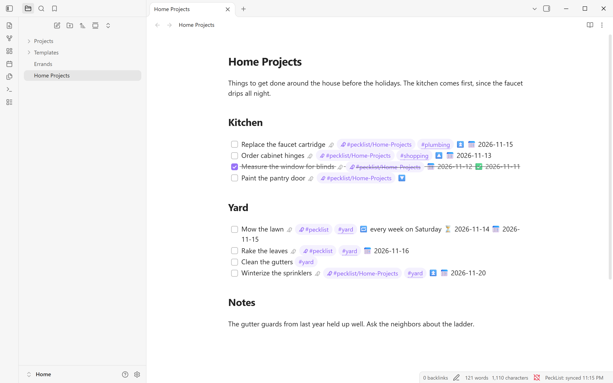
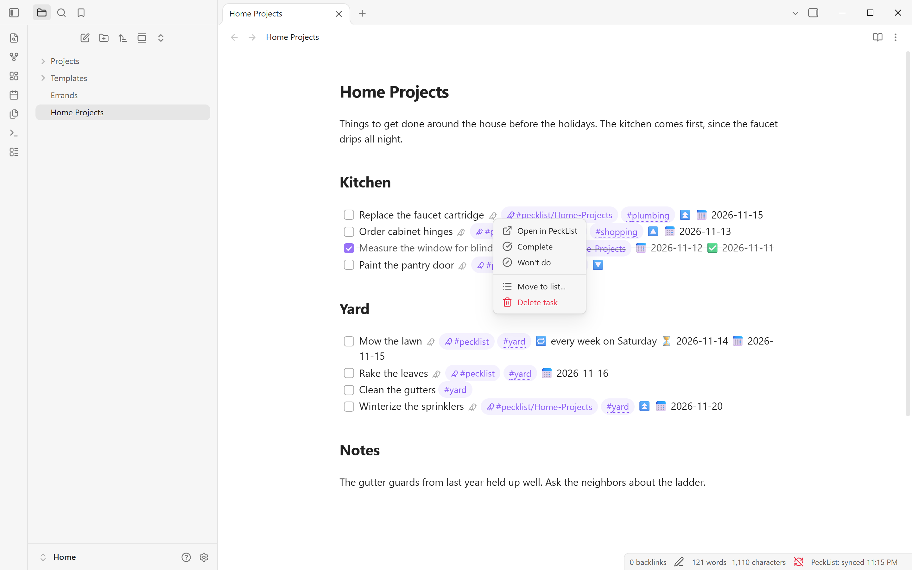
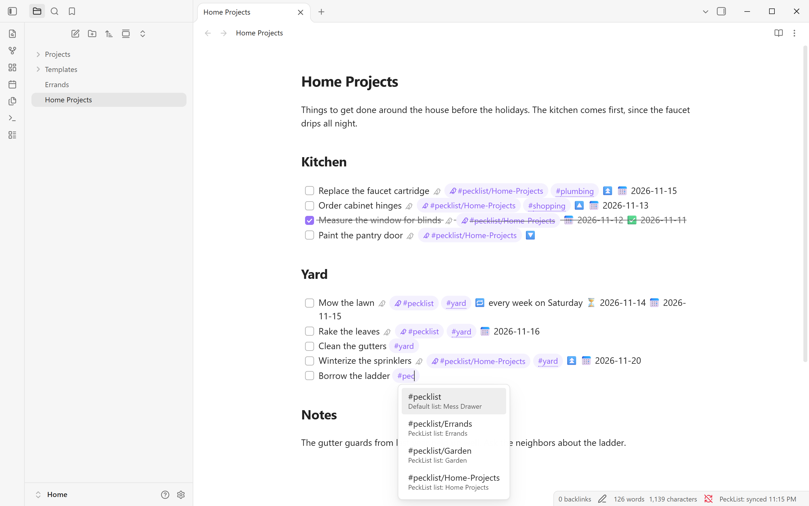
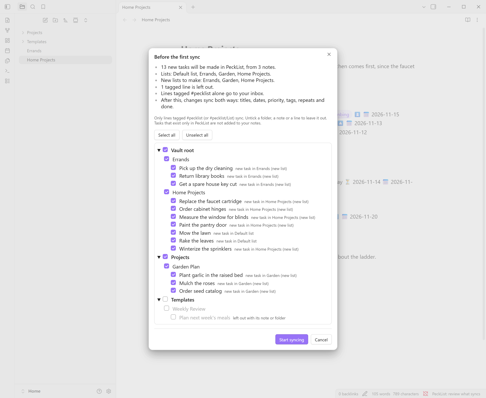
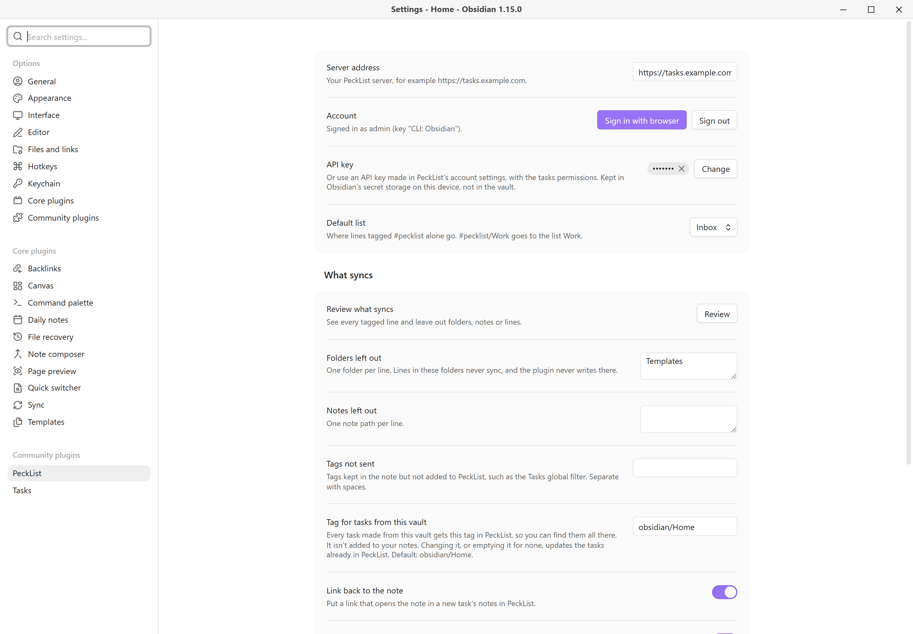

# PeckList for Obsidian

Sync task lines in your notes with your own [PeckList](https://gitlab.com/killswitch10/pecklist) server, both ways. Write a task in the [Tasks](https://github.com/obsidian-tasks-group/obsidian-tasks) plugin's format, tag it `#pecklist`, and it shows up in PeckList. Change it on your phone and the line in your note follows.

Works on Obsidian desktop and mobile (1.13 or later). Needs the community **Tasks** plugin and a PeckList server (0.10 or later).

The full guide, with every setting, is at [pecklist.com/obsidian](https://pecklist.com/obsidian/).



| | |
|---|---|
|  |  |
| Right-click the bird for the task menu | Suggestions for PeckList lists and tags |
|  |  |
| The review before the first sync | Settings |

## Network use and accounts

This plugin talks to **one server: the PeckList server whose address you enter in its settings**, usually one you or your household run yourself. Nothing is sent anywhere else, and there is no telemetry.

- It needs an **account on that PeckList server** to work.
- It sends the task lines you tag (title, dates, priority, tags, repeat, done), and the list each goes to. If **Link back to the note** is on (the default), a new task's notes get an `obsidian://` link holding your vault's name and the note's path.
- It reads tasks back from the server to update those lines.
- Untagged lines, the rest of your notes, and notes in folders you leave out are never read for sending.
- **Vault files:** to find tagged lines, the plugin lists the Markdown notes in your vault and reads the ones whose tags include a PeckList tag (from Obsidian's own tag index). The tag suggestions list the tags already used in your vault the same way. None of this leaves your device except the tagged lines described above.
- **Clipboard:** the sign-in window's **Copy code** button puts its one-time code on your clipboard, so you can paste it in the browser. The plugin never reads the clipboard.

## Getting started

1. Install and enable the **Tasks** plugin.
2. Install this plugin, open its settings and enter your server's address (for example `https://tasks.example.com`).
3. Select **Sign in with browser**. Your browser opens your server's sign-in page. Sign in there as you usually do and type the code the plugin shows. The plugin never sees your password. Or paste an API key made in PeckList (under API keys in your account settings) with the `tasks:read` and `tasks:write` permissions.
4. Pick a **Default list**, or leave it on Inbox.
5. Before the first sync, a review lists every tagged line by folder and note, with a summary of what will happen. Untick folders, notes or single lines to leave them out, then select **Start syncing**. Each device reviews once.

## Which lines sync

- Only task lines with a PeckList tag sync:
  - `#pecklist` goes to the default list;
  - `#pecklist/Work` goes to the list "Work".
- List names are matched ignoring case, and `-` or `_` stand for spaces, so `#pecklist/Home-Projects` goes to "Home Projects". A list that doesn't exist yet is made.
- Lines that are already done when first seen are not sent.
- Folders and notes can be left out in the settings or in the review. `Templates` is left out by default. The plugin never writes into a left-out folder.
- A single line can be left out in the review. That adds `%%[pecklist:: off]%%` to it, and deleting the mark brings it back.

Once a line is linked, the plugin adds a hidden id to it, such as `%%[pecklist:: 01JC8R5K2Z4N6PX0M3WQ7HB9TA]%%`. It's an Obsidian comment, so it doesn't show in reading view. It sits before the dates so the Tasks plugin still reads them. Leave it there: it's how a later edit updates the same task instead of making a new one.

## What syncs

| In the note (Tasks format) | In PeckList |
|---|---|
| The line's text | Title |
| `#pecklist`, `#pecklist/List` | The list |
| Other tags (`#yard`, `#home/garden`) | Tags (new ones are made) |
| ⏫ or 🔺 / 🔼 / 🔽 or ⏬ | High / medium / low priority |
| 📅 due date | Due date |
| ⏳ scheduled date | Date (start) |
| 🔁 every ... | Repeat |
| `[x]` with ✅ date / `[-]` with ❌ date | Done / won't do |

- **Not synced:** 🛫 start and ➕ created stay in the note only. Tags in **Tags not sent** (by default the Tasks plugin's global filter, such as `#task`) stay in the note only.
- **Times:** the Tasks plugin's dates have no time of day. A time set in PeckList stays on the server when the date moves in the note.
- **Repeats** in these forms are translated both ways:
  - every day, week, month or year;
  - every N of those;
  - every weekday;
  - given weekdays;
  - a day of the month;
  - the nth or last weekday of the month;
  - "when done".

  Other forms stay as written on each side. PeckList moves a repeating task to its next date. When you tick a repeating line, the Tasks plugin writes the next line itself, and the plugin completes the task once and gives the new line the server's dates.

## In the editor

- **The bird:** in Live Preview the hidden id shows as a small bird. Click it to open the task in PeckList. Right-click it for the task menu: **Open in PeckList**, **Complete**, **Won't do** (or **Reopen** on a closed task), **Move to list...** and **Delete task**. Each one edits the line, so undo in the note brings it back, and the change syncs right away. A repeating task is completed through the Tasks plugin, the same as ticking its box. **Delete task** removes the line and moves the task to PeckList's trash.
- **Suggestions:** typing `#pec` on a task line suggests your PeckList lists. On a line that syncs, typing another tag suggests tags from your vault and from PeckList together. Everywhere else Obsidian's own tag suggestions show as usual.
- **Tag marks:** on lines that sync, list tags get a small bird and the tags sent to PeckList get a dotted underline, in Live Preview and in reading view. They use your theme's tag color. Turn them off with **Mark PeckList tags** in the settings.

## How both ways works

- **Edits:** only the fields that changed are sent, so a title edit in Obsidian and a date change on your phone both survive. If the same field changed on both sides, the newer change wins.
- **Deleted in Obsidian:** deleting a linked line, or taking its PeckList tag off, moves the task to PeckList's trash, where it can be restored. If many linked lines disappear at once, the plugin asks first.
- **Deleted in PeckList:** when a task is deleted in PeckList, or its list stops being shared with you, the line stays in your note as plain text, without the tag and id.
- **Made in PeckList:** tasks made in PeckList itself are not added to your notes.
- **When it syncs:** at startup, a few seconds after a tagged line changes, on a timer (every 5 minutes by default), and with the **Sync now** command. Offline changes wait for the next sync.
- **Several devices:** several devices can share a vault through Obsidian Sync, Syncthing and the like. Each device keeps its own sync state and signs in on its own. The API key is kept in Obsidian's secret storage on the device, not in the vault.

## Settings

- **Server address**, **Account** (Sign in with browser, Sign out) and **API key** (kept in secret storage on the device).
- **Default list:** where lines tagged `#pecklist` alone go.
- **Review what syncs**, **Folders left out**, **Notes left out** and **Tags not sent**.
- **Tag for tasks from this vault:** every task made from the vault gets this tag in PeckList (`obsidian/<vault name>` by default). It's never written into notes. Changing it, or emptying it for none, updates the tasks already in PeckList.
- **Link back to the note** and **Mark PeckList tags**.
- **Sync on a timer** and **Start over on this device**.

## Commands

- **Sync now**
- **Review what syncs**
- **Sign in with browser**

## Development

```bash
npm install
npm run dev        # rebuilds main.js on change
npm run build      # type-check and production build
npm run lint
npm test           # unit tests, with a fake server and vault
```

`npm run test:contract` runs the sync engine against a real PeckList server. Use a throwaway local container, never one with real data:

```bash
PECKLIST_URL=http://localhost:18181 PECKLIST_TOKEN=pl_... npm run test:contract
```

The screenshots in `docs/screenshots/` are 2x captures of a demo vault synced to a throwaway local PeckList server.

To try it in Obsidian, copy `main.js`, `manifest.json` and `styles.css` into `<vault>/.obsidian/plugins/pecklist/`. Use a test vault.

The plugin uses only PeckList's public Task API (`/api/v1/`), which only ever gains fields, so an older plugin keeps working with a newer server.

- `src/core/`: the Tasks line format, repeats and list tags. No Obsidian imports.
- `src/api/`: the Task API client.
- `src/sync/`: the sync engine.
- `src/obsidian/` and `src/ui/`: everything that touches Obsidian.

This project started from the [Obsidian sample plugin](https://github.com/obsidianmd/obsidian-sample-plugin) (0-BSD) at commit `07ceb81`, keeping its build setup.

The project lives on [GitLab](https://gitlab.com/killswitch10/pecklist-obsidian), where merge requests go. Issues are welcome on GitLab or GitHub. [GitHub](https://github.com/KillSwitchIO/pecklist-obsidian) is a read-only mirror, where releases for Obsidian are built: push a tag matching `manifest.json` (plain `x.y.z`, after `npm version`) and the mirror's release workflow publishes `main.js`, `manifest.json` and `styles.css`.

## License

[AGPL-3.0-or-later](LICENSE), like PeckList.
